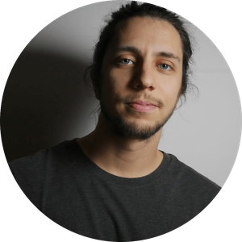

# Marco Ferretti

*Full Stack engineer with strong expertise in distributed systems, scalable backend architectures, and high-volume data platforms. Experienced in Go, Rust, and Node.js microservices, performance optimization, and end-to-end testing. Comfortable owning complex features from design to deployment, collaborating in distributed teams, and mentoring engineers. From* 🇮🇹

[Email](mailto:mferretti93@gmail.com) / [LinkedIn](https://www.linkedin.com/in/marcodellemarche) / [GitHub](https://github.com/marcodellemarche) / [Instagram](https://www.instagram.com/marcodellemarche) / [Remote Workers](https://rok.co/@marcodellemarche)

📎 Download this CV [as a PDF](https://github.com/marcodellemarche/cv/releases/download/latest/marco-ferretti-cv.pdf)

## Core Skills

- **Languages**: Go, Rust, TypeScript, Python, Bash
- **Backend**: PostgreSQL, Redis, Kafka, Node.js
- **Frontend**: React, Angular, Next.js
- **Infrastructure**: Docker, Kubernetes, CI/CD, Bazel
- **Other**: E2E + unit testing, distributed systems, microservices architecture, performance optimization

## 💻 Engineering Experience

**Fullstack Developer (Frontend → Backend → Distributed Storage Platform)** @ [CUBBIT](https://cubbit.io) *(Jul 2021 - Present)*

Geo-distributed cloud storage platform based on a peer-to-peer network of nodes.

- **Frontend**: Built and launched customer-facing web applications using React and TypeScript, serving >5,000 users.
- **Backend**: Developed backend microservices in Go, Rust, enabling the platform to handle up to 8,000 req/s.
- **Database**: Designed, optimized, and maintained a PostgreSQL OTLP database system, scaling it from zero to >20 TB of data while improving throughput, query latency and database health.
- **Infrastructure**: Contributed to CI/CD, containerization, and orchestration workflows using Docker, Kubernetes, Bazel, Kafka, and Redis.
- **Observability**: Implemented logging, monitoring, and alerting systems on Grafana, to ensure high availability and quick incident response.
- **Team & Processes**: Led task scoping, technical discussions, and code reviews within a distributed engineering team.
- **Hiring**: Co-led technical interviews and evaluated candidates on backend and system-design topics.
- **Testing**: Ensured high reliability via strong testing practices, including extensive unit and E2E test coverage.

*Technologies*: Go, Rust, PostgreSQL, Kafka, Docker, Kubernetes, TypeScript, Node.js, OpenTelemetry, React, Jest, Bazel.

**Frontend Developer (Frontend)** @ [JMA Wireless](http://jmawireless.com) *(Oct 2019 - Jul 2021)*

Software-driven 4G mobile provider, designed specifically for in-building and outdoor use.

- Automated key installation steps using Python and Bash, reducing setup time and configuration errors.
- Developed Angular tools to streamline server installation and monitoring for internal teams.
- Configured over 50 CentOS-based Dell servers and prepared them for production deployment.

*Technologies*: Angular, TypeScript, Node.js, Bash, Python.

## Publications

- [Optimizing PostgreSQL Queries: Index Best Practices & Techniques](https://medium.com/cubbit/optimizing-postgresql-queries-index-best-practices-techniques-81c25615a84e)
- [Table Partitioning in PostgreSQL: Performance & Bloat](https://medium.com/cubbit/table-partitioning-in-postgresql-performance-bloat-7c248dd2d604)
- [Autovacuum in PostgreSQL Database](https://medium.com/cubbit/autovacuum-in-postgresql-database-472679e678d3)
- [PostgreSQL WAL, Replication, Checkpoints](https://medium.com/cubbit/postgresql-wal-replication-checkpoints-6681b8e0a0f1)

## 🚀 Open Source Projects

**[Cubbit Seal](https://github.com/marcodellemarche/cubbit-seal)** — Browser-based encrypted file sharing over Cubbit S3, with zero backend.

- Single React + TypeScript app with client-side AES-256-GCM encryption via the Web Crypto API; no server ever sees plaintext or passwords.
- Supports files of any size via multipart upload with per-chunk encryption and streaming in-browser decryption — no full file loaded into memory.
- Password embedded in the URL fragment (`#p=…`); SigV4 presigning implemented manually in the browser with no time limit.

*Technologies:* TypeScript, React, Web Crypto API, AWS SDK, Vite.

**[Cubbit Pages](https://github.com/marcodellemarche/cubbit-pages)** — Go CLI for deploying static sites to Cubbit S3, with optional end-to-end encryption.

- Encrypts each file with AES-256-GCM (PBKDF2 key derivation) and injects a login page + service worker that decrypts assets transparently in the browser.
- Supports named profiles, dry-run, smart clean (removes stale remote files), deep status, and self-update via GitHub Releases.
- Published as pre-built binaries for Linux, macOS, and Windows.

*Technologies:* Go, AWS SDK v2, AES-256-GCM, Service Workers, GitHub Actions.

**[cvmd](https://github.com/marcodellemarche/cvmd)** — Markdown-first CV template with automated PDF generation — the template this CV is built on.

- GitHub Actions pipeline renders the CV to a styled PDF on every push and attaches it to a GitHub Release.
- Setup wizard personalizes placeholders and generates an LLM prompt to rewrite the content from scratch.
- Supports circular profile photos, Open Graph images, and custom domains via GitHub Pages.

*Technologies:* Jekyll, GitHub Actions, Python, GitHub Pages.

## 📡 Telecommunications Experience

*This section only accounts for previous experiences not related to software development.*

**Field Engineer** @ [JMA Wireless](https://www.jmawireless.com) *(Apr 2018 - Oct 2019)*

Software-driven 4G mobile provider, designed specifically for in-building and outdoor use.

- Configured 4G radio parameters in collaboration with teams in Italy and the USA to meet customer requirements.
- Provided on-site support during server installations and troubleshooting, completing >10 client deployments internationally.

## 👨‍🎓 Education

**Master's Degree in Telecommunications Engineering** @ [Università di Bologna](https://www.unibo.it) *(Oct 2015 - Mar 2018)*

Focus on digital communications, signal processing, networking, and distributed systems.

**Bachelor's Degree in Electronic Engineering** @ [Università Politecnica delle Marche](https://www.univpm.it) *(Oct 2012 - Jul 2015)*

Coursework in electronics, embedded systems, and information theory.

## 🚃 Other courses

**Railway high formation course** @ [Rete Ferroviaria Italiana](https://www.rfi.it) *(Jun 2017 - Aug 2017)*

Three-month university course on the Italian railway system.

## 💬 Languages

🇮🇹 **Italian**: Native

🇺🇸 **English**: Fluent

🇪🇸 **Spanish**: Conversational

🇵🇹 **Portuguese**: Conversational

*I authorize the processing of personal data contained in my curriculum vitae based on art. 13 GDPR 679/16.*
